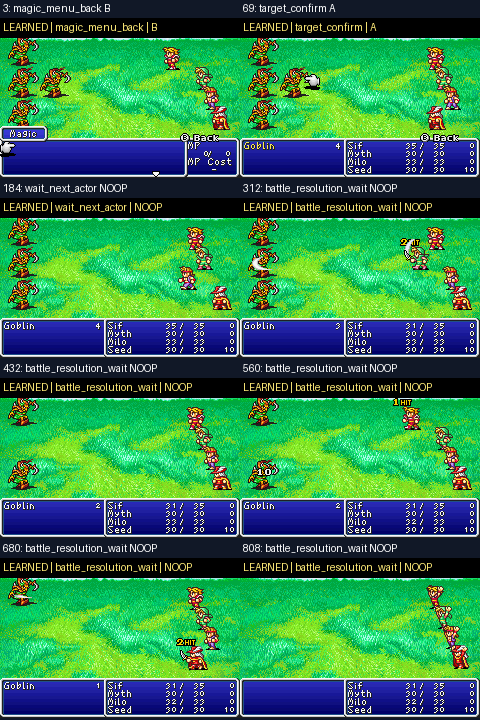

# Issue #19 — Live combat imitation and continuous play

## Result

A bounded, real WSL/GBA workflow now runs the trained combat policy inside the autonomous field loop. The official Sif/Myth/Milo/Seed checkpoint and NES v0.7 were left unchanged. The learned run entered three battles, won all three with reviewed EXP banners (6, 6, and 4 EXP), and resumed field movement after its first two wins. Its third win was also confirmed; the controller then stopped safely because the post-battle map view did not match its reviewed camera anchors.

The same seed and initial checkpoint under the scripted combat baseline produced the same three wins, rewards, and two movement resumptions. The model is real supervised behavior cloning from game screenshots and expert choices, but it has not improved on the script.

## Training evidence

The final trainer input combined five local capture folders. Exact replay duplicates were removed and sibling menu-state branches were merged back into their original battle-command encounter groups before splitting. The final set contains 53 unique observations across six encounter parents: 35 training rows, 10 validation rows, and 8 test rows. Training saw 33 `A` labels and 2 `B` labels. Validation and test accuracy were both 100%; the test group contains only `A`, so that score is a weak single-class diagnostic and must not be read as broad action generalization.

No PPO or RL optimizer ran. The model only handles the reviewed Goblin interface: `B` backs out of a confirmed Magic menu and `A` selects Attack/target on confirmed panels.

## Matched live branch comparison

All three policies started from the same held-out Goblin encounter parent at a reviewed Magic-menu state:

| Policy | Confirmed win | EXP | Meaningful choices | Result |
|---|---:|---:|---:|---|
| Learned | Yes | 6 | 10/10 executed | `B` once, then `A` nine times |
| Scripted | Yes | 6 | 10/10 executed | Same expert sequence |
| Seeded random | No | — | 2 executed, 1 rejected | Safely stopped after choosing `B` on the Attack panel |

The learned model chose the correct Magic-menu recovery action on a parent held out from optimizer training, then completed the battle. This demonstrates narrow menu-action imitation on a held-out encounter state, not a new combat strategy or enemy generalization.

The screenshot sheet below is from the learned held-out branch. The full GIFs remain local.

## Full recording locations

The primary watchable run is local at `videos/gba_autoplay/20261029_182917_704300Z/autoplay.gif`. Its same-seed scripted comparator is `videos/gba_autoplay/20261029_182321_611128Z/autoplay.gif`. Matched branch recordings are under `videos/gba_combat_branch_eval/` for run IDs `20261029_183043_885907Z` (learned), `20261029_183048_727478Z` (scripted), and `20261029_183053_617778Z` (random). The local model is `models/gba_combat_bc_issue19.npz`; it is deliberately not published.

The compact sanitized aggregate is in `metrics.json`. ROM, checkpoints, raw observations, action traces, trained weights, and full GIFs are excluded from Git.

## Tests and next step

The full WSL unittest suite passed: 114 tests. `compileall`, the GBA autoplay dry-run, and the new double-clickable learned-launcher `--dry-run` passed through CMD → PowerShell → WSL. The launcher confirmed the local model and runtime without starting gameplay. Stable-Retro, Gymnasium, SB3, and the existing integration were already installed and usable; nothing was reinstalled.

Next, collect successful labels from another enemy species and target-menu layout, validate HP/survival observations independently, and repeat the same held-out learned/scripted/random comparison. Keep rewards neutral and PPO disabled until those signals are reliable.
